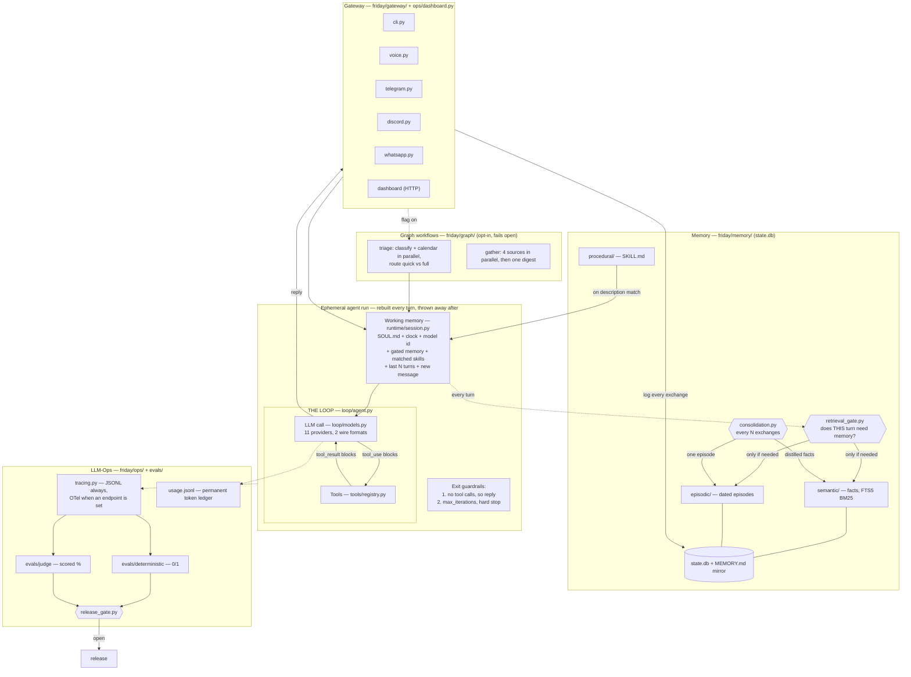

# Friday — Architecture

Friday is a local-first personal assistant built as a **readable blueprint** of the four
pillars behind every serious agent:

| Pillar | Question it answers | Where it lives |
|---|---|---|
| **Harness** | How does a message get in, and a reply get out? | `friday/gateway/`, `friday/runtime/`, `friday/app.py` |
| **Loop** | How does the model reason and act until it is done? | `friday/loop/`, plus `friday/graph/` for structure *around* the loop |
| **Memory** | What persists after the process exits? | `friday/memory/`, one SQLite file |
| **Eval / LLM-Ops** | How do we know it still works after a change? | `friday/ops/`, `evals/` |

Nothing here is a framework. The loop is 114 lines. The graph engine is 206. The whole
package is roughly 14k lines including the dashboard, eleven providers and six gateways.

---

## 1. The one-page picture



---

## 2. Request lifecycle — one turn, end to end

`friday/app.py` is the assembly diagram in code. Read it first.

1. **A gateway receives text.** Every gateway does exactly one thing: move text in and
   out. It tags the message with a `source` (`cli` / `voice` / `telegram` / `discord` /
   `whatsapp` / `dashboard`) and calls `Friday.respond()`. No gateway holds agent logic.
2. **Observers are composed.** `respond()` fans every event out to three sinks at once:
   the gateway's live display, the `Tracer`, and a small capture dict that records the
   gate and route decisions so they can be persisted with the turn.
3. **Optional graph front door.** If `FRIDAY_GRAPH_WORKFLOWS=1`, the message enters the
   triage graph first. Any failure — classifier, engine, anything — falls open to the
   plain loop. The flag can make a turn faster or cheaper, never worse.
4. **Working memory is assembled** (`runtime/session.py`): `SOUL.md`, the local clock with
   timezone, the model/provider identity, memory retrieved *only if the gate says so*, any
   `SKILL.md` whose description matches, and the last `history_turns` exchanges.
5. **The loop runs** (`loop/agent.py`): reason, act, observe — until the model stops asking
   for tools or `max_iterations` is hit.
6. **The turn is persisted.** The exchange lands in `chat_log` with a JSON `meta` blob
   (gate decision, graph route, iterations, latency, per-tool status, model, provider) so
   a reopened thread can re-render the full turn card, not just the text.
7. **Consolidation may fire**, and `MEMORY.md` is regenerated.
8. **`turn_end` is written** to the day's trace file.

---

## 3. Harness

### Gateways (`friday/gateway/`)

| File | Channel | Notes |
|---|---|---|
| `cli.py` | terminal | the zero-setup default (`friday`) |
| `voice.py` | microphone | wake word (default `"friday"`, comma-separated variants), local Whisper STT, macOS `say` or local Kokoro TTS |
| `telegram.py` | phone | needs `TELEGRAM_BOT_TOKEN` |
| `discord.py` | server or DM | needs `DISCORD_BOT_TOKEN`; can run on its own memory home |
| `whatsapp.py` | phone | Meta Cloud API; needs a public URL |
| `runner.py` | — | one thread-owned `Friday` per async gateway (Friday is synchronous and owns a SQLite connection) |
| `supervisor.py` | — | adapter-agnostic start/stop/status for background gateways |
| `ops/dashboard.py` | browser | a stdlib `ThreadingHTTPServer` on `127.0.0.1:7777` |

The dashboard is a gateway too — the browser is only the UI; the same local process runs
every turn. `ops/browser_agent.py` holds the single shared `Friday` across its threads.

### Working memory (`friday/runtime/session.py`)

Everything in a turn's prompt is rebuilt per turn and discarded. History is a **sliding
window** (`FRIDAY_HISTORY_TURNS`, default 12), so context, cost and latency stay flat no
matter how long a conversation runs — older turns live in `state.db` and come back through
the retrieval gate. Tool activity is folded into the assistant's history entry as a compact
`[tools used: ...]` line; without it the model forgets it already acted and re-runs the
same tool (the triple-booked-meeting bug).

`SOUL.md` is the editable persona file, written on first run into `FRIDAY_HOME`.

### Configuration (`friday/config.py`)

A single dataclass read once at startup, no settings framework. Every knob is an env var
documented in `.env.example`. `.env` discovery uses `find_dotenv(usecwd=True)` so an
installed Friday finds the `.env` in the directory you are standing in, not the one next
to `site-packages`.

---

## 4. The Loop (`friday/loop/agent.py`)

```
while not done:
    response = llm(messages, tools)      # reason
    if response asks for tools:
        results = run(tool_calls)        # act
        messages += results              # observe
    else:
        done                             # reply to the human
```

Two exit guardrails, and only two: the model stops requesting tools (natural end of turn),
or `max_iterations` is reached (hard stop, never spins forever). `messages` is mutated in
place, so after the call it *is* the full working memory of the turn — which is exactly
what gets traced.

Streaming is optional and degradable: `stream=True` emits `text` deltas for the live UI,
and **any** streaming hiccup silently falls back to a single non-streamed call.

### Providers (`friday/loop/models.py`)

The loop speaks exactly one dialect — Anthropic's Messages shape. Eleven providers plug in
through two wire formats:

- **anthropic wire (native):** Anthropic, Kimi/Moonshot, GLM/Z.ai, MiniMax
- **openai wire (a ~60-line adapter):** OpenAI, Gemini, DeepSeek, OpenRouter, xAI,
  OpenCode Zen, OpenCode Go

`OpenAICompatClient` translates content blocks and `tool_calls` in both directions,
streaming included, and absorbs three real-world details: Gemini's `thought_signature` must
be echoed back or the follow-up 400s; older endpoints only know `max_tokens`, not
`max_completion_tokens`; and some endpoints return HTTP 200 with an error body and no
choices at all.

A model id inherited from the env for a *different* provider is dropped rather than carried
across a provider switch. That leak once made the retrieval gate 400 on every turn and fail
open silently — which looks exactly like a healthy "retrieve" decision.

### Tools (`friday/tools/`)

A tool is three things: a name and description the model reads, a JSON schema, and a Python
function returning a string. `ToolRegistry.execute` **surfaces errors as text instead of
raising** — the model observes the failure and can retry; the loop never crashes.

Always registered: `create_event`, `list_events`, `save_note`, `send_message`, `search_web`,
and the memory self-management trio `manage_memory` / `update_soul` / `create_skill`.

Opt-in, each behind a flag because *every registered tool ships in every prompt*:

| Flag | Adds |
|---|---|
| `FRIDAY_APPLE_TOOLS=1` | Apple Calendar / Mail / Reminders / Notes via AppleScript (macOS) |
| `FRIDAY_GH_TOOL=1` | read-only GitHub through the `gh` CLI's own auth (no token stored) |
| `FRIDAY_EXPERIMENTAL=1` | `delegate_task` (hands coding work to the `pi` sub-agent) plus declared skeletons |
| `.friday/mcp.json` exists | every tool exposed by the listed MCP servers |

The **footprint ladder** governs where new capability goes: extend existing code, then a
skill, then a CLI, then a tool behind an extra, then a gateway, and only as a last resort a
new core tool.

---

## 5. Graph workflows (`friday/graph/`) — structure *around* the loop

The loop is one agent turn. Some work has **shape**: steps that can run at the same time,
and explicit "if this, go there" routing. A graph makes that shape first-class without
touching `loop/agent.py` — the `full_agent` node calls the *same* `_run_full_turn` method
the flag-off default runs, so loop-as-a-node cannot drift from loop-as-default.

The engine (`engine.py`) runs **waves**:

```
while some nodes are ready:
    run every ready node (at the same time, if there are several)
    merge what they wrote into the shared state
    fire their edges / ask their routers where to go next
```

Three ideas carry it:

- **state** — one plain dict. Parallel nodes must write **disjoint** keys; a collision
  raises `GraphStateCollision` instead of silently losing a write.
- **routers** — plain Python functions over state. Models *write* state; code *reads* it
  and picks the edge. **No LLM ever decides control flow directly.**
- **guards** — per-node `max_visits` (bounded cycles) plus a global `max_steps`. A node
  exception is recorded in `state["errors"]` and surfaced, never raised out of the run.

Node factories (`nodes.py`): `tool_node` (pure function), `llm_node` (one call, no tools),
`agent_node` (**a whole loop turn as one node**), `key_router`, `fn_node`.

Shipped workflows:

- **`triage`** — the front door when `FRIDAY_GRAPH_WORKFLOWS=1`. A small model classifies
  the message *while* today's calendar loads in parallel; trivial messages get a fast
  small-model reply and never wake the big model; real tasks route into the normal loop.
- **`gather`** — the morning briefing as a graph: GitHub, web, calendar and memory fetched
  concurrently, then one digest. `friday brief` is the same job as a plain loop, which is
  what makes the two directly comparable.

`Graph.describe()` returns the topology as data and the dashboard draws from that, so the
picture in the UI cannot drift from the code.

A graph is **not** multi-agent: execution follows the edges deterministically, which is
precisely why it can be traced and eval'd like everything else.

---

## 6. Memory (`friday/memory/`)

One SQLite file, `FRIDAY_HOME/state.db`. Open it yourself:
`sqlite3 .friday/state.db ".tables"`.

| Kind | Answers | Storage |
|---|---|---|
| **Semantic** | "what is durably true?" | `facts` + `facts_fts` (FTS5/BM25 keyword search) |
| **Episodic** | "what happened, and when?" | `episodes` + `episodes_fts`, every row dated |
| **Procedural** | "how should I act here?" | `SKILL.md` files — markdown, no Python |

Plus `chat_log` (every exchange, tagged with `session_id`, `source` and a `meta` JSON blob)
and `calendar_events` (the flagship task's artifact, which the deterministic evals assert on
directly).

### Hero moment 1 — the retrieval gate (`retrieval_gate.py`)

Most agents hit their memory store on every turn. That is slow, and worse: irrelevant
memories bias the answer. So before touching any store, a cheap model answers one narrow
question — *does THIS message need the user's memory?*

```
you > what's 2+2?                 gate - skip     (pure math)
you > when am I meeting Alex?     gate - retrieve (references user's plans)
```

It **fails open**: if the gate errors, or returns no JSON at all (reasoning models spend a
thinking block first), Friday retrieves anyway. A stale memory beats a lost one.

### Consolidation (`consolidation.py`)

Batched, not per-message: only after `FRIDAY_CONSOLIDATE_EVERY` new exchanges (default 6)
does a cheap model read the unconsolidated log and distill it into durable facts plus one
dated episode. It is **loss-safe** — if the summarizer fails or truncates, rows stay
unconsolidated for next time and nothing is dropped.

### `state.db` vs `MEMORY.md`

Both, deliberately. `state.db` is the queryable source of truth; `MEMORY.md` is a
human-readable mirror regenerated after every turn, so "your memory is a file you can open"
is literally true without giving up FTS5.

### Pluggable backends

`semantic/base.py` defines the contract and a conformance suite holds every backend to it,
which is why a hosted service can stand in for local SQLite without anything upstream
noticing.

| `FRIDAY_SEMANTIC_STORE` | Backend |
|---|---|
| `sqlite` (default) | FTS5 keyword search, zero setup |
| `supabase` | pgvector embeddings (`sql/init_supabase.sql`) |
| `mem0` / `zep` / `langmem` | hosted memory services (the `[arena]` extra) |

`FRIDAY_EPISODIC_STORE` is `sqlite` (default) or `notion`.

### Procedural memory

`SKILL.md` files in Anthropic's Agent Skills format: YAML frontmatter with `name` and
`description`, where the description doubles as the trigger. The loader searches the bundled
`skills/` folder **and** `FRIDAY_HOME/skills/`; `bundled_skill_dirs()` checks two locations
because a checkout has `skills/` at the repo root while a wheel has it at `friday/skills`.

---

## 7. Eval and LLM-Ops (`friday/ops/`, `evals/`)

### Two kinds of eval that never mix

| | Deterministic | LLM-as-judge |
|---|---|---|
| Question | "Did the right tool fire?" | "Was the reply any good?" |
| Verdict | 0 or 1 | a scored % against a threshold |
| Where | `evals/deterministic/` (62 files, plain pytest) | `evals/judge/` (DeepEval) |
| Command | `make eval` | `make eval-judge` |

Conflating a unit test with a scored opinion is the most common eval mistake, so they stay
separate suites you can diff. `make gate` (`ops/release_gate.py`) runs both: deterministic
must pass 100% or the gate closes; judge runs when an API key is present. Each run appends
to `eval_runs.jsonl`, so the Ops tab shows history, not just the latest verdict.

**The bug discipline:** when a bug is found live, fix it *and* add a deterministic case so
it can never come back.

### Tracing (`ops/tracing.py`)

Always on, zero dependencies: every turn appends readable lines to
`FRIDAY_HOME/traces/<date>.jsonl` — `turn_start`, `gate`, `llm`, `tool`, `llm`, `turn_end`.
Set `OTEL_EXPORTER_OTLP_ENDPOINT` and the same events also export as OpenTelemetry spans to
Phoenix, Langfuse, or any OTLP backend. The instrumentation does not know which.

### Spend ledger

Every LLM call appends provider, model and token counts to `FRIDAY_HOME/usage.jsonl`. It is
**append-only and never wiped** by a demo reset, because tokens are the ground truth; dollar
cost is derived from them in `ops/pricing.py` (prices change, tokens do not).

### The arenas

- **Model race** (`ops/arena.py`) — one message, N models, each running the *real* harness.
- **Memory race** (`ops/memory_arena.py`) — harness and model held constant, the memory
  backend varied.
- Scoring splits the same way as the evals: `ops/scoring.py` is deterministic completion
  ("did the expected tool fire"), `ops/judge.py` scores quality.
- Arena results live in their own JSONL scoreboard (`ops/compare_history.py`), deliberately
  **never** in `state.db` — a benchmark is not the agent's memory.

### The dashboard (`ops/dashboard.py` + `static/`)

`friday dashboard` serves `http://localhost:7777`. Stdlib HTTP server, plain static JS, no
build step. A chat dock sits on every tab; tabs are Overview, Gateway, Loop, Graph, Memory,
Tools, Database, Ops, the two Arena races, and Setup (Models, Connections, Behaviour).

### Integrations (`friday/integrations.py`)

One declarative registry — no I/O in the declarations — behind every surface: the
Connections tab, `friday connections`, and the health probes. It covers channels (Telegram,
Discord, WhatsApp), calendar and productivity (Google Calendar, Apple Calendar, Apple
Tools), memory and storage (Notion, Mem0, Zep, LangMem, Supabase), search and observability
(Tavily, OpenTelemetry), and every AI provider.

---

## 8. Design decisions worth stealing

- **Gate before retrieval**, not retrieval on every turn — it saves latency and keeps
  irrelevant memories from biasing answers.
- **Everything optional fails open.** The retrieval gate, the triage graph, streaming, the
  MCP bridge, OTel. The degraded path is always the plain, working path.
- **Errors surface as text, never as crashes** — in `ToolRegistry.execute` and in the graph
  engine alike. The model can react to a failure it can read.
- **Consolidation is batched and loss-safe.** A failed summarizer leaves the log intact.
- **Models write state; code reads it.** Routers are plain functions. No LLM steers control
  flow directly.
- **Deterministic and judged evals never mix**, and the release gate treats them differently.
- **Every layer has a boring default and a documented upgrade** — FTS5 to pgvector, mock
  calendar to Google or Apple, JSONL to Phoenix or Langfuse. The default is always
  zero-signup.
- **Draw the diagram from the code.** The dashboard renders graph topology from
  `Graph.describe()`, so the picture cannot lie.
- **The footprint ladder.** Every registered tool costs prompt space in *every* turn, so
  capability lives at the edges and the core stays narrow.

## 9. What this deliberately is not

Not a framework. Not multi-agent — a graph's `agent_node` is the same loop invoked as one
step, with no peer-to-peer messaging, and execution follows the edges deterministically.
Not production infrastructure. It is the afternoon read that explains what the big
assistants are doing under the hood.

## 10. Where state lives

Everything runtime is under `FRIDAY_HOME` (default `./.friday/`, gitignored):

```
.friday/
  state.db              facts, episodes, chat_log, calendar_events
  MEMORY.md             human-readable mirror, regenerated every turn
  SOUL.md               the editable persona
  skills/               skills you or the agent wrote
  calendar.ics          the local calendar artifact
  outbox/               drafted messages, delegate logs
  traces/<date>.jsonl   one line per event
  usage.jsonl           permanent token ledger (never wiped)
  eval_report.json      latest gate verdict
  eval_runs.jsonl       gate history
  mcp.json              optional MCP server config
```
