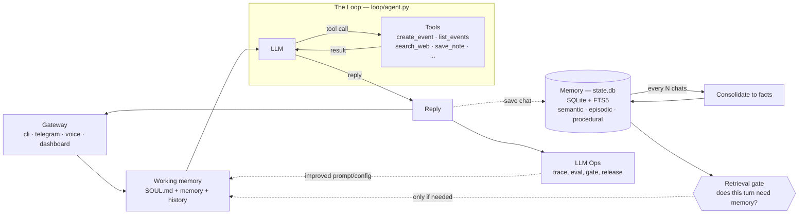

# Friday

**A local-first personal assistant that runs on your laptop.**

[](https://github.com/ShauryaaSharma/FRIDAY/blob/v2/architecture.png)

- **Local-first.** Memory is one SQLite file at `.friday/state.db`. Open it, read it,
  it is yours. Nothing leaves the machine unless you connect something that does.
- **Three kinds of memory.** Semantic facts, dated episodes, and procedural skills,
  with a gate that decides whether a turn needs memory at all.
- **Eleven providers, one loop.** Bring whichever model you already pay for.
- **A local dashboard** at `localhost:7777` for chat, memory, traces and cost.
- **Eval and tracing built in.** Deterministic tests and LLM-as-judge, behind a
  release gate.

Design document: **[ARCHITECTURE.md](https://github.com/ShauryaaSharma/FRIDAY/blob/main/ARCHITECTURE.md)**.

---

## Quickstart

Just want to run it:

```bash
pip install friday-ai-agent-harness
friday                                  # talk to Friday in the terminal
friday dashboard                        # ...or the browser cockpit at localhost:7777
```

It tells you which key to set the first time. To run from source instead:

```bash
git clone https://github.com/ShauryaaSharma/FRIDAY && cd FRIDAY
uv venv && uv pip install -e .          # create the env + install the `friday` command
cp .env.example .env                    # pick a provider, paste ONE key
uv run friday                           # terminal chat
uv run friday dashboard                 # ...or the cockpit at localhost:7777
```

`uv run friday ...` needs no venv activation. Three ways to run it:

| Command | When |
|---|---|
| `uv run friday dashboard` | quick start, zero activation (recommended) |
| `source .venv/bin/activate` then `friday dashboard` | activate once, bare `friday` all session |
| `uv tool install .` then `friday dashboard` | install `friday` globally, forever |

`friday` and `friday dashboard` are two doors into the **same** Friday. The dashboard is a
tiny web server on *your* machine — chat in the browser and that process runs the turn.
Nothing leaves your laptop. Set `TELEGRAM_BOT_TOKEN` and it starts your bot too.
(`make dashboard` works as well.)

**Now try it.** *"Remember that Alex prefers morning meetings."* Quit. Restart.
*"Book a catch-up with Alex on Friday."* It remembers, and books 9am. Your memory is one
file: `.friday/state.db`.

### Bring the model you already pay for

Eleven providers, one loop, one dialect. Set `FRIDAY_PROVIDER=` and paste that provider's
key:

| Wire format | Providers |
|---|---|
| anthropic (native) | Anthropic (default), Kimi/Moonshot, GLM/Z.ai, MiniMax |
| openai (a ~60-line adapter) | OpenAI, Gemini, DeepSeek, OpenRouter, xAI, OpenCode Zen, OpenCode Go |

The adapter is [`friday/loop/models.py`](https://github.com/ShauryaaSharma/FRIDAY/blob/main/friday/loop/models.py) — the entire difference
between the two wire formats is worth reading once. OpenRouter is one key in front of
hundreds of models, and its defaults here are `:free` ids, so you can run with no spend at
all.

---

## Watch the harness run — the dashboard

```bash
friday dashboard        # local server at http://localhost:7777
```

A small web server you own (`127.0.0.1`, no cloud). The browser is only the UI; the same
process runs every turn. This is the fastest way to *get* the system.

A chat dock sits on every tab. Type or speak, and watch the message flow through the harness
on the Overview diagram: the gate lights up, the loop calls a tool, the reply comes back,
memory updates. The frontend is plain static files. No build step.

| Tab | What you see |
|---|---|
| **Overview** | cost, latency, the gate skip/retrieve split, the clickable architecture map |
| **Gateway** | one conversation across every channel, each message tagged by source |
| **Loop** | every turn with its gate decision, tool calls, iterations, tokens and cost |
| **Graph** | the live triage topology, drawn from the engine itself, and the door each turn took |
| **Memory** | sub-tabs per pillar: semantic facts, episodes, editable skills, SOUL, consolidation |
| **Tools** | available tools grouped by origin, their results, and MCP connectors |
| **Database** | a live SQLite browser over `state.db` with a read-only SQL console |
| **Ops** | eval verdict and history, gate decisions, slowest turns, inline JSONL traces |
| **Arena** | model race and memory race, scored live |
| **Setup** | Models, Connections, Behaviour — BYOK, kept in your local `.env` |

The sidebar and chat dock are drag-resizable, and the chat has *New chat* plus history like
any chat app.

---

## Things to try

| Try this | What it shows | Where to watch |
|---|---|---|
| *"Schedule a tennis game with Raj this Saturday at 8am"* | the loop calls a tool (`create_event`) | the LOOP box pulses; Loop tab shows `iter 2` |
| *"What's on my calendar today?"* | reading the calendar (`list_events`) | answers from `state.db`, no invented events |
| *"When am I swimming with Sergey?"* then *"what's 12 x 8?"* | the retrieval gate: retrieve vs skip | Overview gate bar; Ops shows the per-turn decision |
| *"Remember that Raj prefers evening games"* | memory self-management (`save_note`) | Memory > Semantic gains a fact; `MEMORY.md` updates |
| *"Search the World Cup games still left and add each to my calendar"* | multi-tool loop engineering | Loop tab shows `iter 8`: `search_web` x N then `create_event` x N |
| chat from `make run` **and** the browser | one brain, many gateways | Gateway tab tags each message `cli` / `dashboard` |

`search_web` works keyless via DuckDuckGo, but that endpoint rate-limits bots, so for a
clean run set a free `TAVILY_API_KEY`.

---

## Graph workflows

Some work has shape: steps that can run in parallel, and explicit routing. A graph
workflow makes that shape first-class, arranging calls around the loop rather than
replacing it — the engine is [one file](https://github.com/ShauryaaSharma/FRIDAY/blob/main/friday/graph/engine.py).

Set `FRIDAY_GRAPH_WORKFLOWS=1` (in `.env`, or the dashboard's Behaviour tab) and
*every* message enters the triage graph first — you never
pick a mode, the harness decides. A small model classifies the message *while* today's
calendar loads in parallel. *"thanks!"* gets a fast small-model reply and never wakes the
big model; *"schedule a swim Saturday"* routes into the exact same loop as before, running
as one node. Any failure anywhere **fails open** to the plain loop, so the flag can only
save time and tokens.

`friday gather` is the second workflow: the morning briefing run as a graph (GitHub, web,
calendar and memory fetched in parallel, then one digest). `friday brief` is the same job as
a plain loop, which makes the two directly comparable.

---

## Memory — three pillars, one file

| Kind | Answers | Where |
|---|---|---|
| **Semantic** | what is durably true | `facts` table, FTS5 keyword search |
| **Episodic** | what happened, and when | `episodes` table, every row dated |
| **Procedural** | how to act here | `SKILL.md` files, loaded only when relevant |

The queryable source is `state.db`; a human-readable `.friday/MEMORY.md` mirror is
regenerated after every turn.

A retrieval gate runs first: a cheap model decides whether a message needs memory at
all, so unrelated turns skip the store entirely. If the gate errors it retrieves anyway.

Consolidation is batched: only after N new exchanges does a cheap model distill the chat log
into durable facts plus one dated episode. If the summarizer fails, nothing is lost — the
log simply stays unconsolidated.

### It manages its own memory

- **manage_memory** — correct or forget a fact when you say it is wrong.
- **update_soul** — save a standing preference you give it (lives in `SOUL.md`).
- **create_skill** — when you teach it a repeatable workflow, it offers to save it as a
  skill (written to `.friday/skills/`, live the same session).

You can edit all of it by hand on the dashboard's Memory tab too.

### Add skills

Skills are procedural memory: markdown instructions loaded only when relevant.
Writing one is just a markdown file — copy [`skills/TEMPLATE.md`](https://github.com/ShauryaaSharma/FRIDAY/blob/main/skills/TEMPLATE.md)
into `skills/<name>/SKILL.md`. `scripts/validate_skills.py` checks the frontmatter.

To pull one in from elsewhere:

```bash
python -m friday skill install https://github.com/<someone>/<repo>/blob/main/skills/<skill>/SKILL.md
```

---

## Eval, tracing and catching bugs

```bash
make eval          # deterministic: "did the right tool fire?" — 0 or 1, no model judges it
make eval-judge    # LLM-as-judge: "was the reply helpful?" — a scored %, needs a key
make gate          # the release gate: deterministic 100%, judge above threshold
```

Deterministic tests are plain pytest in [`evals/deterministic/`](https://github.com/ShauryaaSharma/FRIDAY/tree/main/evals/deterministic); judged
ones use DeepEval in [`evals/judge/`](https://github.com/ShauryaaSharma/FRIDAY/tree/main/evals/judge). Results show in the terminal and on the
dashboard's Ops tab: the gate verdict, an eval-history table (one row per `make gate`), the
per-turn gate decisions, and raw traces inline.

**Spend is permanent.** Every LLM call's tokens are appended to `.friday/usage.jsonl`, an
append-only ledger a demo reset never wipes. The Ops tab shows all-time cost, tokens, and a
per-day / per-provider breakdown (dollars are estimated from tokens, which are the ground
truth).

**Tracing is always on.** Every turn appends readable lines to `.friday/traces/<date>.jsonl`
with zero setup. For span-waterfall views:

```bash
pip install -e '.[tracing]'
make trace                                            # Phoenix at localhost:6006
OTEL_EXPORTER_OTLP_ENDPOINT=http://localhost:4317 make run
```

Langfuse cloud speaks the same OTel toggle.

---

## Where each piece lives



Every box is one module — the full version, with the request lifecycle and the design
decisions, is in **[ARCHITECTURE.md](https://github.com/ShauryaaSharma/FRIDAY/blob/main/ARCHITECTURE.md)**:

| Diagram box | Module |
|---|---|
| Gateway interface (CLI / voice / Telegram / Discord / WhatsApp / web) | [`friday/gateway/`](https://github.com/ShauryaaSharma/FRIDAY/tree/main/friday/gateway) |
| Ephemeral agent run, working memory | [`friday/runtime/session.py`](https://github.com/ShauryaaSharma/FRIDAY/blob/main/friday/runtime/session.py) |
| Wiring: config, db, tools, memory, session, loop | [`friday/app.py`](https://github.com/ShauryaaSharma/FRIDAY/blob/main/friday/app.py) |
| The loop (LLM and tools, end-loop guardrails) | [`friday/loop/agent.py`](https://github.com/ShauryaaSharma/FRIDAY/blob/main/friday/loop/agent.py) |
| Providers: 11 of them, 2 wire formats | [`friday/loop/models.py`](https://github.com/ShauryaaSharma/FRIDAY/blob/main/friday/loop/models.py) |
| Graph workflows (structure around the loop) | [`friday/graph/`](https://github.com/ShauryaaSharma/FRIDAY/tree/main/friday/graph) |
| Agentic tools (schedule / note / message / search) | [`friday/tools/`](https://github.com/ShauryaaSharma/FRIDAY/tree/main/friday/tools) |
| Procedural memory (SKILL.md, "how to act") | [`friday/memory/procedural/`](https://github.com/ShauryaaSharma/FRIDAY/tree/main/friday/memory/procedural) + [`skills/`](https://github.com/ShauryaaSharma/FRIDAY/tree/main/skills) |
| Semantic memory (durable facts) | [`friday/memory/semantic/`](https://github.com/ShauryaaSharma/FRIDAY/tree/main/friday/memory/semantic) |
| Episodic memory (dated events, past chats) | [`friday/memory/episodic/`](https://github.com/ShauryaaSharma/FRIDAY/tree/main/friday/memory/episodic) |
| "Should we even retrieve?" gate | [`friday/memory/retrieval_gate.py`](https://github.com/ShauryaaSharma/FRIDAY/blob/main/friday/memory/retrieval_gate.py) |
| Consolidate after N chats | [`friday/memory/consolidation.py`](https://github.com/ShauryaaSharma/FRIDAY/blob/main/friday/memory/consolidation.py) |
| Trace, one per run | [`friday/ops/tracing.py`](https://github.com/ShauryaaSharma/FRIDAY/blob/main/friday/ops/tracing.py) |
| Eval: deterministic vs LLM-as-judge | [`evals/deterministic/`](https://github.com/ShauryaaSharma/FRIDAY/tree/main/evals/deterministic) vs [`evals/judge/`](https://github.com/ShauryaaSharma/FRIDAY/tree/main/evals/judge) |
| Gate to release | [`friday/ops/release_gate.py`](https://github.com/ShauryaaSharma/FRIDAY/blob/main/friday/ops/release_gate.py) |

---

## Connect it to your life

Voice, Telegram, Discord, WhatsApp, Apple Calendar and Mail, Google Calendar, Notion, MCP
servers — each one is opt-in, behind its own extra, and none of them change the loop. Setup
for all of them: **[docs/integrations.md](https://github.com/ShauryaaSharma/FRIDAY/blob/main/docs/integrations.md)**. The dashboard's
Connections tab configures and health-checks each one.

## Upgrade paths (when you outgrow the defaults)

| Default (zero setup) | Upgrade | How |
|---|---|---|
| SQLite FTS5 keyword memory | Supabase pgvector semantic search | `FRIDAY_SEMANTIC_STORE=supabase` plus [sql/init_supabase.sql](https://github.com/ShauryaaSharma/FRIDAY/blob/main/sql/init_supabase.sql) |
| Mock calendar (ICS + SQLite) | Apple / Google Calendar | `FRIDAY_APPLE_CALENDAR=1` (macOS) or `FRIDAY_GOOGLE_CALENDAR=1` with `pip install -e '.[gcal]'` |
| Hand-built memory pillars | mem0 / Zep / LangMem | `pip install -e '.[arena]'` and set `FRIDAY_SEMANTIC_STORE`, then race them in the Memory arena |
| Episodes in SQLite | Notion database | `FRIDAY_EPISODIC_STORE=notion` with `pip install -e '.[notion]'` |
| JSONL traces | Phoenix / Langfuse | set `OTEL_EXPORTER_OTLP_ENDPOINT` |

## Roadmap — the boxes beyond the flagship task

These live in [`friday/tools/experimental.py`](https://github.com/ShauryaaSharma/FRIDAY/blob/main/friday/tools/experimental.py), off by default;
`FRIDAY_EXPERIMENTAL=1` registers them.

| Box | Tool | Status |
|---|---|---|
| Sub-agents | `delegate_task` | **live** — delegates coding tasks to [pi](https://github.com/earendil-works/pi) |
| Graph workflows | [`friday/graph/`](https://github.com/ShauryaaSharma/FRIDAY/tree/main/friday/graph) | **live** behind `FRIDAY_GRAPH_WORKFLOWS=1` |
| Terminal tool | `run_command` | skeleton — needs a real sandbox and safety surface first |
| Browser tool | `browse_web` | skeleton — `search_web` covers read-only lookups today |
| Cron job | `schedule_task` | skeleton — `make brief` plus a system cron line covers it today |

```bash
npm install -g --ignore-scripts @earendil-works/pi-coding-agent
FRIDAY_EXPERIMENTAL=1 uv run friday
# "have pi fix the failing test in ~/my-project"
```

The full pi transcript lands in `.friday/outbox/delegate-*.log`; tune the budget with
`FRIDAY_DELEGATE_TIMEOUT` (default 300s).

## Every command

The `friday` command is installed with the package; the `make` targets are equivalent
aliases.

| Command | Does |
|---|---|
| `friday` | chat in the terminal |
| `friday dashboard` | the live cockpit at localhost:7777 (plus Telegram if configured) |
| `friday voice` | talk to it — hands-free wake word, or push-to-talk |
| `friday telegram` / `discord` / `whatsapp` | message it from your phone or a server |
| `friday brief` | morning briefing from calendar + mail + memory, as a loop |
| `friday gather` | the same job as a graph: four sources in parallel, then one digest |
| `friday connections` | list configured integrations and their health |
| `friday skill install <url>` | install a skill from a URL |
| `make trace` | deep trace waterfalls (Phoenix) at localhost:6006 |
| `make eval` / `make eval-judge` / `make gate` | the two eval suites and the release gate |
| `make shootout RUNS="..."` | same tasks, different brains, scored |
| `make lint` | ruff over `friday`, `evals`, `scripts` |

## Repo layout

```
friday/
  app.py            wiring: config -> db -> tools -> memory -> session -> loop
  config.py         every knob, one dataclass
  db.py             the whole SQLite schema
  gateway/          cli, voice, telegram, discord, whatsapp
  runtime/          working-memory assembly
  loop/             THE loop + 11 providers
  graph/            engine, node factories, workflows/
  memory/           semantic, episodic, procedural + gate + consolidation
  tools/            calendar, notes, messages, search, memory admin, adapters
  ops/              tracing, dashboard, arenas, scoring, release gate
evals/
  deterministic/    0/1 pytest
  judge/            scored DeepEval
skills/             bundled SKILL.md files
docs/               reference and write-ups
```

Runtime state lives in `.friday/` and is gitignored.

[MIT licensed](https://github.com/ShauryaaSharma/FRIDAY/blob/main/LICENSE).
